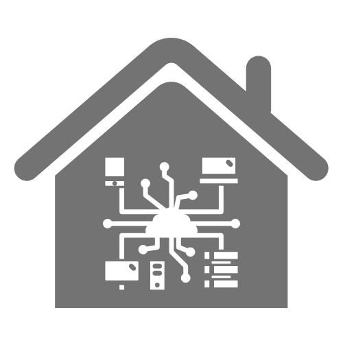

<h1 align="center">
   
  
   
  <b>Home Server</b>
   
  
  
</h1>

 

## Presentation

I carried out this project in my spare time since april 2024.

The aim of this project was to repurpose an old machine that was gathering dust into a server by hosting services that could help me in my day-to-day life.
As I went along, a new goal emerged: to replace my cloud services with open-source services that can be hosted locally.

I started by installing Debian on the machine, then removed the graphical interface and set up Docker, which I use to containerize my services.

 

## Features

Over time, I set up the following features:

+ Container, image, and volume management with **Dockhand**.
+ Main dashboard with **Home Assistant** (in development).
+ DNS server with **Pi-Hole** configured to block ads and trackers.
+ Hosting my phone’s photo gallery with **Immich**
+ Hosting my college projects and personal projects with **Gitea**
+ Hosting wikis and documentation with **Kiwix**
+ Database management with **AppFlowy**
+ Hosting my documents with **NextCloud**
+ Hosting my calendars with **Radicale**, which I can then manage via **Home Assistant** and **Davx5** on my mobile
+ Synchronizing my documents between my server, my laptop and my mobile with **Syncthing**
+ Storing my passwords with **KeePassXC** (soon to be replaced by **VaultWarden**)
+ CV builder and job application tracking with **Reactive Resume**
+ Hosting numerous tools with **Omni-Tools**

 

## Languages, Tools, and Software Used

